# AI 漫剧工坊

小说 → 剧本 → 资产 → 分镜 → 视频 的 AI 漫剧创作流水线（单用户本地工具，纯云端 API + 国内生态）。

**前后端分离架构**：`frontend/`（Vite + React 19）+ `backend/`（FastAPI + Celery + PostgreSQL + Redis）。

> ### 🎬 在线 Demo（纯 GitHub 托管 · 零后端 · 手机可看）
>
> **👉 https://snow-sakura.github.io/comic-video/**
>
> Demo 是本项目真实运行产物的静态快照（示例项目《青灯引魂》：小说原文 → 角色定妆照 → 13 镜头分镜墙 → 微动态视频 / 配音 / 成片播放器），单 HTML + 内嵌数据，全部资源托管在 GitHub（Pages + 仓库文件），数据已脱敏。仓库入口 [`demo/index.html`](demo/index.html)。

## 目录结构

```
comic-video/
├── frontend/                  # 前端（Vite + React 19 + TypeScript + Tailwind v4）
│   ├── src/
│   │   ├── pages/             # 页面（Home / Project / Settings / Tasks + mobile/）
│   │   ├── components/
│   │   │   ├── web/           # Web 端四步工作台（script/asset/storyboard/compose）
│   │   │   ├── mobile/        # 移动端组件
│   │   │   └── shared/        # 两端共享
│   │   ├── api/               # 后端 API 客户端（开发走 Vite 代理 → :8000）
│   │   ├── hooks/  lib/       # 自定义 hooks / 工具库
│   │   └── App.tsx            # 路由（/ /projects/:id /settings /tasks + /m/* 移动端）
│   ├── vite.config.ts         # 代理 /api、/file → http://localhost:8000
│   └── package.json
├── backend/                   # 后端（FastAPI + Celery）
│   ├── run.py                 # ⭐ 后端启动入口（python run.py [--host/--port/--reload]）
│   ├── app/
│   │   ├── main.py            # FastAPI 应用工厂（路由聚合 + CORS + 静态素材）
│   │   ├── api/               # REST 路由（项目/剧本/资产/分镜/合成/任务/设置…）
│   │   ├── core/              # 配置(.env) / 数据库(asyncpg) / Redis / Celery
│   │   ├── models/            # SQLAlchemy 模型（11 张表）
│   │   ├── agents/            # 剧本工坊三智能体（LLM + 启发式回退）
│   │   ├── providers/         # 供应商适配器（文本/图像/视频/配音，可插拔 + Mock）
│   │   ├── assets/ storyboard/ compose/  # 资产工厂 / 分镜车间 / 视频合成
│   │   ├── novel/ prompts/ export/ subtitles/ quality/ cost/ retry/
│   │   └── storage/           # 本地文件存储分类（novels/shots/videos/audio/exports…）
│   ├── workers/tasks.py       # Celery 任务处理器（script/image/video/audio/compose 五类）
│   ├── scheduler/tier.py      # 免费/付费档位解析 + worker 进程组计划
│   ├── batch_plan.py          # 启动脚本消费的进程组 CLI（python -m app.batch_plan）
│   ├── alembic/               # 数据库迁移（baseline 已 stamp）
│   ├── requirements.txt  .env  .env.example   # .env 配置（git 忽略，含真实密钥）
│   └── .venv/                 # Python 虚拟环境（git 忽略）
├── scripts/
│   ├── start.sh               # ⭐ 一键启动全部（API + Worker + 前端）
│   ├── start-backend.sh       # 仅后端（FastAPI + Celery）
│   └── start-frontend.sh      # 仅前端（Vite）
├── docs/                      # 产品需求 / 技术选型 / 架构 / 实施计划 / 操作指南 / specs / 截图
├── demo/                      # 🎬 在线 Demo（纯静态单页，GitHub Pages 托管；build.py 重新生成）
└── backend/storage/           # 生成资产：成片 exports/、分镜 shots/、配音 audio/…（git 忽略）
```

## 技术栈

| 层 | 技术 |
|---|---|
| 前端 | Vite 7 + React 19 + TypeScript + Tailwind CSS v4 + React Router 7 |
| 后端 | FastAPI + Uvicorn + SQLAlchemy 2 (async) + asyncpg + Pydantic v2 |
| 队列 | Celery 5（Redis broker，按档位物理拆分为 free/paid 队列组）+ 状态机 + 前端轮询进度；免费档 solo 串行、付费档 prefork 并行 |
| 数据 | PostgreSQL（11 表）+ Redis + 本地文件存储（`backend/storage/`） |
| 迁移 | Alembic（异步引擎，baseline 已 stamp） |
| AI 供应商 | 文本 / 图像 / 视频全可插拔（默认统一 Agnes 最新版：agnes-3.0-flash / agnes-image-2.5-flash / agnes-video-2.5-flash）；配音默认小米 MiMo-TTS 官方免费额度，可切 TokenDance 音频网关；未配 Key 自动 Mock |
| 合成 | ffmpeg 逐镜头拼接 + 配音/BGM 混音 + SRT 字幕 |

## 完整执行流程（四步流水线 · 图文详解）

在项目工作台内按 **任务 01 → 02 → 03 → 04** 顺序推进，左侧步骤条 + 小步骤导航 + 底部「上一步 / 下一步」翻页引导，每一步完成后自动点亮 ✓。全程任务化异步执行，进度自动刷新。以下截图均来自真实运行（示例项目《青灯引魂》1 集 13 镜）。

**流程总览**：

```
新建项目 → 导入小说 → 提炼角色 → 分集大纲 → 分集剧本
        → 定妆照 + 锁定 → 场景空镜 → AI 分镜 → 批量出图
        → 图生视频 → TTS 配音 → FFmpeg 合成 → 导出成片 ✅
```

---

### 开始：创建项目

**入口**：首页输入项目标题 → 「新建项目」→ 自动进入工作台。

首页同时是所有项目的总控面板：每个项目卡实时显示四步进度（如 `5/12 子步骤 · 42%`）与当前所处阶段。

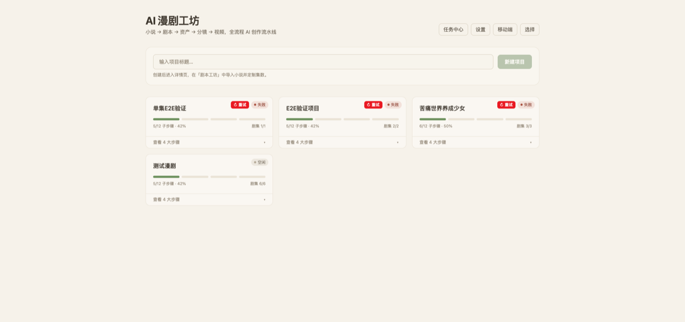
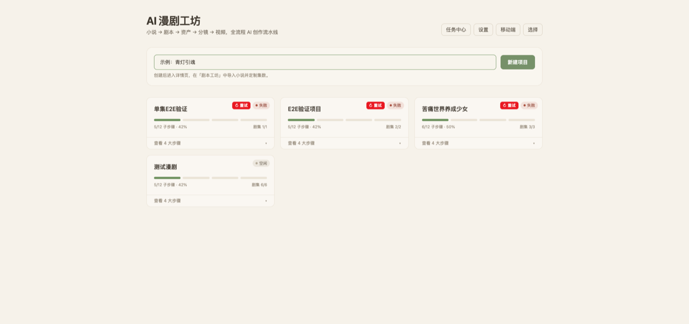

---

### 任务 01 · 剧本工坊 —— 把小说变成可拍摄的剧本

> 小步骤：上传小说 → 提炼角色 → 分集大纲 → 分集剧本

#### ① 导入小说

粘贴正文或上传 `.txt/.md` 文件（支持 10 万字长文本），系统自动按「第 X 章」切分章节并清洗。导入后按钮变「已导入 · N 章」。

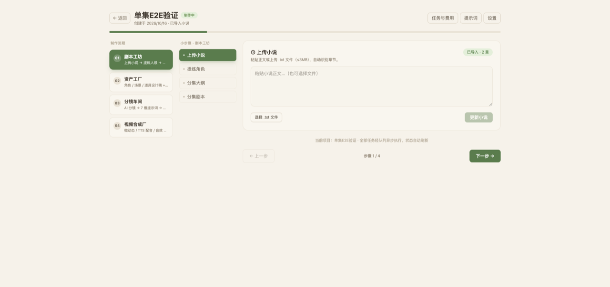

#### ② 提炼角色

LLM 通读小说提炼 4-8 个关键角色，产出三维角色卡：**外貌**（发型/体型/服饰/标志物）、**性格**（风格关键词）、**配音建议**，JSON 结构化、逐项可编辑；无 API Key 时自动启发式提取，流程不中断。

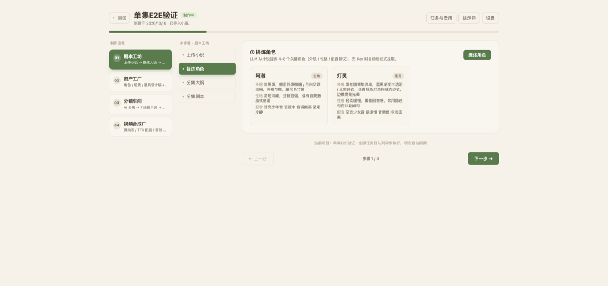

#### ③ 分集大纲

设定集数后一键生成：故事梗概 + 每集标题 / 剧情 / 集尾悬念钩子。每集要求至少 1 个高情绪点（供分镜情绪配色）。

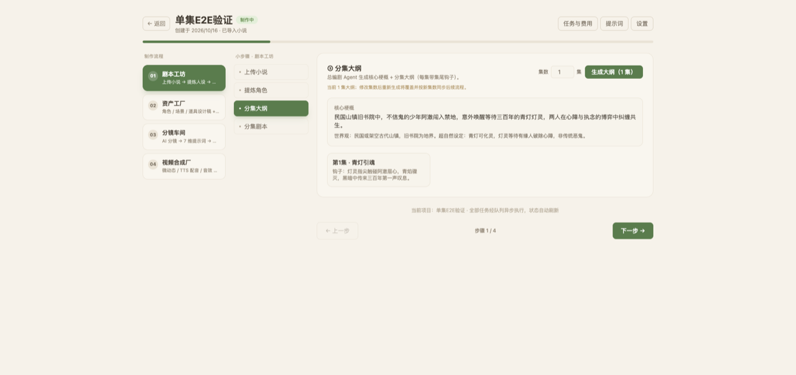

#### ④ 分集剧本

逐集生成完整结构化剧本（场景 / 动作 / 台词 / 情绪），由**编剧 → 分镜 → 润色**三智能体接力完成；已生成集按钮自动禁用防覆盖。

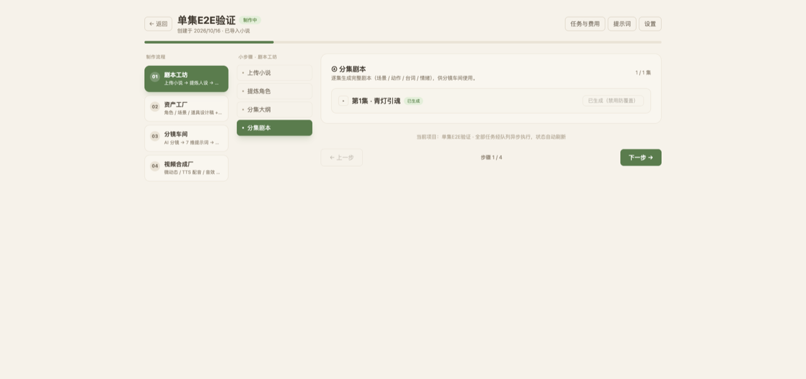

---

### 任务 02 · 资产工厂 —— 一次定妆，镜镜一致

> 小步骤：角色定妆照 → 场景空镜 → 道具设计

#### ① 角色定妆照 + 一致性锁定

每个角色生成 **正面 / 侧面 / 全身** 三张定妆照；「智能匹配音色」按角色性别与性格自动分配 TTS 音色（可手动改）。审阅后点击 **锁定**——锁定（APPROVED）的定妆照将自动作为后续**所有分镜出图的参考图**，这是跨镜头角色一致性的核心机制。

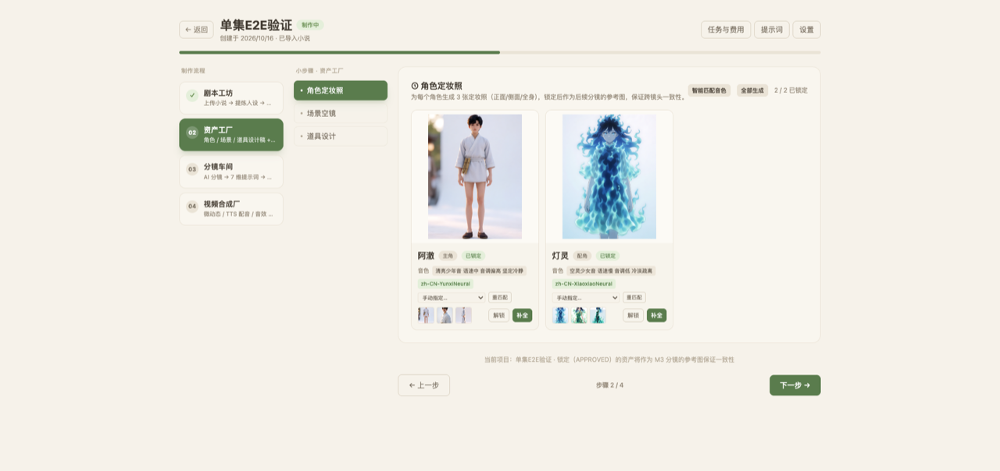

#### ② 场景空镜 / ③ 道具设计

按剧本自动提取场景与道具 list，批量生成无人物环境空镜 / 道具设计稿，同样支持锁定为分镜背景参考。

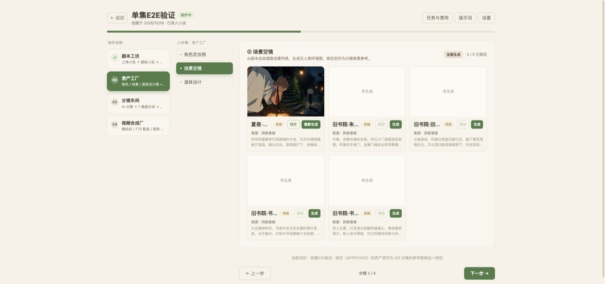
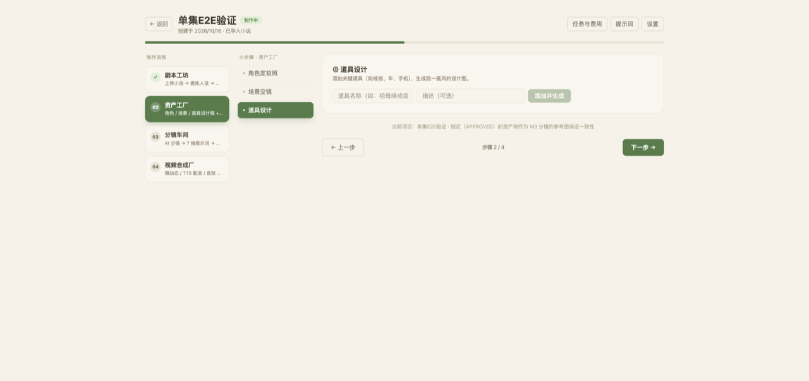

---

### 任务 03 · 分镜车间 —— AI 拆镜 + 7 维提示词 + 逐镜出图

> 小步骤：选择剧集 → 分镜 · 出图

#### ① AI 分镜

选定剧集后点击「AI 分镜」：剧本 → 镜头清单，每个镜头含 **景别 / 机位 / 运镜 / 时长 / 台词 / 动作**，结构校验（每场 3-8 镜）。也可用「手动分镜」逐条添加。

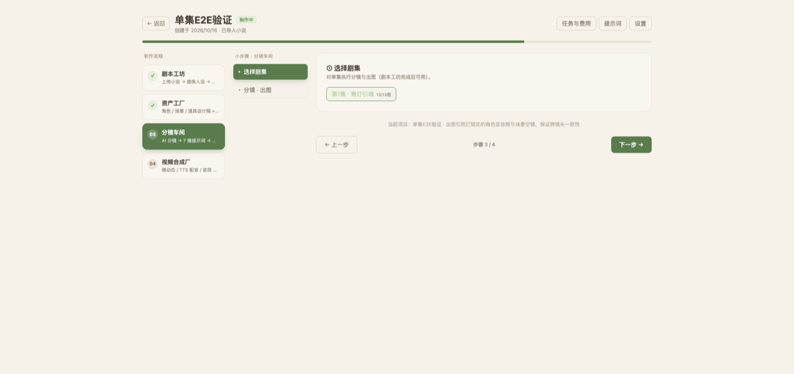

#### ② 批量出图（7 维提示词）

每个镜头自动组装 **7 维提示词**（主体 / 环境 / 构图 / 色彩 / 情绪氛围 / 风格 / 灯光），并自动引用已锁定的角色定妆照 + 场景空镜作参考图（镜头卡显示「N 参考图」）。「批量出图」逐镜独立异步任务，失败单镜可「重出」，不影响其他镜头。

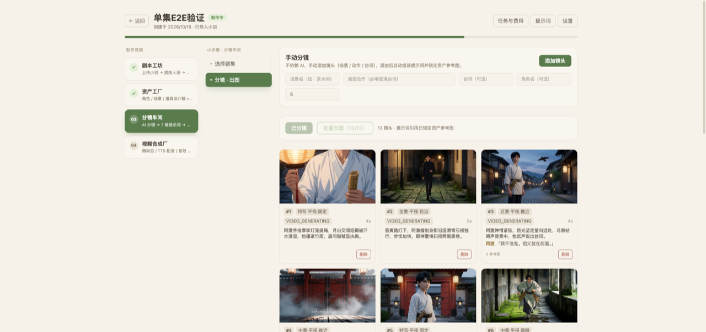


> 💡 **限流自适应**：免费图像模型限流（503/每分钟限额）时任务不会失败——自动退避重试（60→300s，最多 6 次），界面显示 `⏳ 限流等待重试（次）` 琥珀态而非报错。

---

### 任务 04 · 视频合成厂 —— 逐镜成片，自动连播

> 小步骤：选择剧集 → 镜头 · 配音 → 成片预览

#### ① 视频生成（图生微动态）

选中剧集点「▶ 自动逐集生产」：**视频 = 分镜图 + 微动态提示词**（发丝微动 / 光影浮动 / 缓慢平移，5-10s 短镜头）。开启自动连播时，出图完成会自动入队视频任务，无需手动。

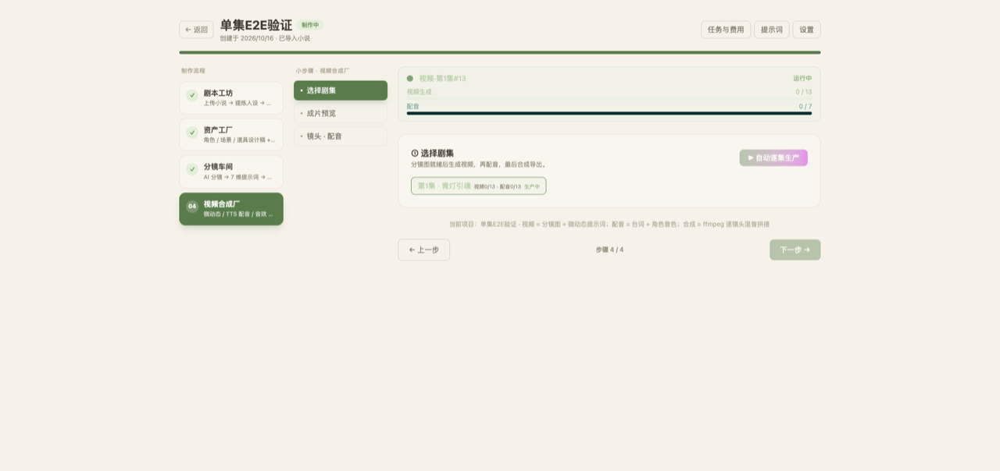

**逐集串行闸门**：多集项目必看——上一集未全部完成视频时，下一集入口自动锁定（🔒 + 禁用），强行请求返回 409（`blockedBy/missing/failed` 明细）；镜头级失败默认阻塞本集，可「跳过该镜头」放行。该设计保证限流配额集中供给当前集、成片素材按序就绪。

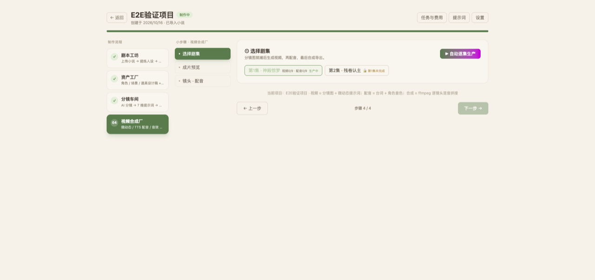

#### ② 配音 / 音效 / BGM

**配音 = 台词 + 角色音色**（资产工厂已匹配），长文本分段合成；背景音乐按情绪匹配；每镜头字幕自动生成。

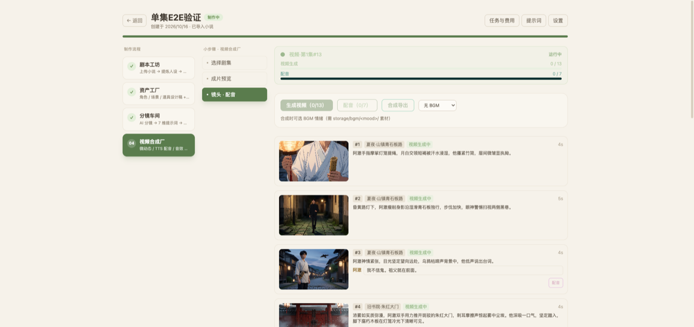

#### ③ 合成导出（成片）

视频 + 配音 + BGM + 字幕 → **ffmpeg 逐镜拼接混音** → 1080p H.264 MP4 + SRT 字幕，落盘 `backend/storage/exports/`；「成片预览」页内直接播放。

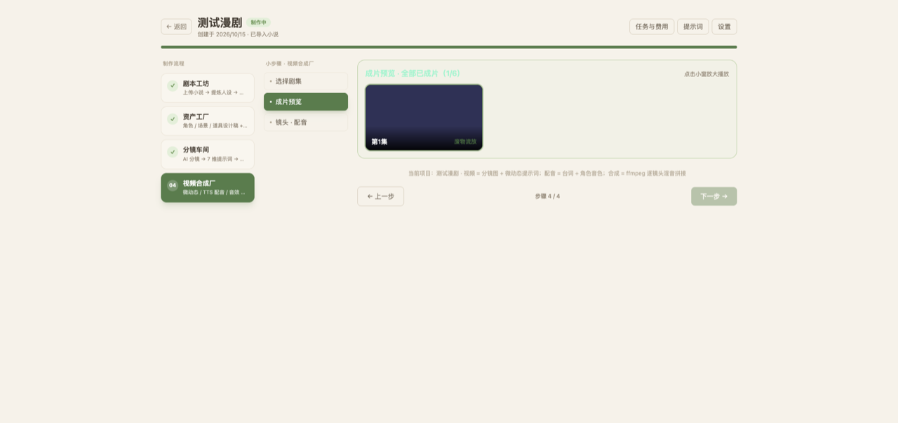

---

### 全局辅助 · 调度透明化

**任务中心**（顶部入口）：跨项目任务表（狀態 / 耗时 / 费用 / 失败原因展开 / ↻重试 / ⏸ 流水线暂停）+ **调度档位徽标**（免费串行档 / 付费并行档 ×N）+ 限流等待态 ⏳ 列。

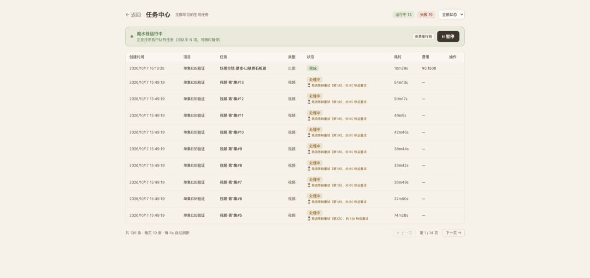

**任务与费用面板**（项目内）：本阶段任务流水、档位徽标、限流等待文案、逐项费用统计。

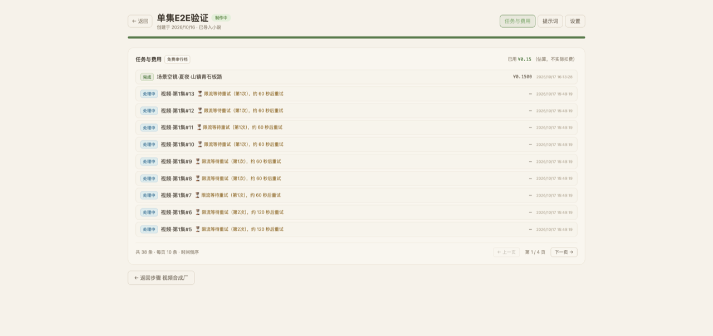

**设置页**：供应商五分组 TABS（通用 / 文本 / 图像 / 视频 / 音频）、模型目录联动、提示词模板 8 类、自动连播开关。

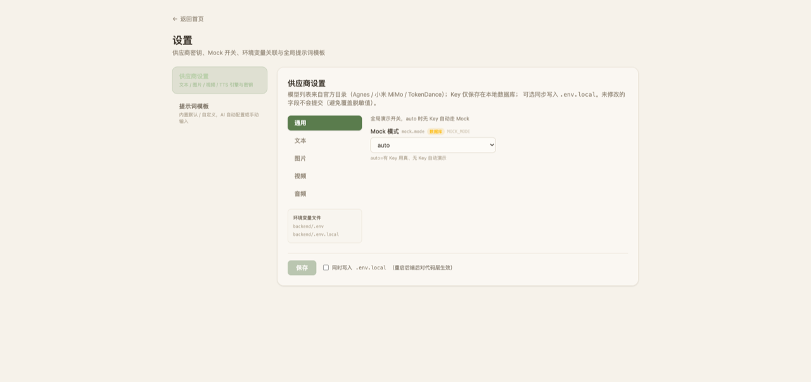

**免费 / 付费档位说明**：

| | 🆓 免费档 | 💎 付费档 |
|---|---|---|
| 判档 | 模型 catalog 标 free（默认 Agnes 全系免费模型） | 标 paid / `SCHED_TIER=paid` 强制 |
| 执行模型 | 单任务串行（solo worker） | 多进程并行（script=2 / image=4 / video=3 / audio=4） |
| 限流处理 | 自动退避重入队，UI 显示 ⏳ 等待 | 同左（触发少） |

## 本地启动

### 前置条件

- **PostgreSQL**：库名 `comic_video`（`brew services start postgresql@18`）
- **Redis**：默认 `localhost:6379`（`brew services start redis`）
- **ffmpeg**：视频合成需要（`brew install ffmpeg`）
- **Python 3.14** + **Node.js 18+**

### 首次准备

```bash
# 1. 后端虚拟环境 + 依赖
cd backend
python3 -m venv .venv
.venv/bin/pip install -r requirements.txt
cd ..

# 2. 前端依赖
cd frontend && npm install && cd ..

# 3. 环境变量（密钥可留空 → 自动 Mock 模式全流程可跑）
cp backend/.env.example backend/.env    # 配置仅后端使用，固定位于 backend/.env
```

### 方式一：一键启动（推荐）

```bash
./scripts/start.sh
```

自动完成：环境检查（ffmpeg/Redis/PostgreSQL）→ 数据库迁移 → 同时启动三进程：

| 进程 | 地址 |
|---|---|
| 前端 Vite | http://localhost:3000 |
| 后端 FastAPI | http://127.0.0.1:8000（交互文档 `/docs`） |
| Celery Worker | 按档位自动拉起进程组（免费=solo 串行；付费=prefork 并行），日志 `backend/logs/worker-<组>.log` |

Ctrl+C 统一退出全部进程。环境变量可覆盖端口：`API_PORT=8080 WEB_PORT=5173 ./scripts/start.sh`

### 方式二：前后端分别启动

```bash
# 终端 1 — 后端（API + Worker）
./scripts/start-backend.sh

# 终端 2 — 前端（含类型检查，SKIP_TYPECHECK=1 可跳过）
./scripts/start-frontend.sh
```

或直接手动命令（在 backend/ 目录下）：

```bash
# 后端 API — 程序入口 backend/run.py
cd backend
.venv/bin/python run.py                        # 默认 127.0.0.1:8000
.venv/bin/python run.py --reload               # 开发热重载
.venv/bin/python run.py --host 0.0.0.0 --port 8080
# 等价方式：.venv/bin/python -m app.main

# Celery Worker（推荐用进程组脚本，自动按档位解析队列与并发）
cd backend && ./scripts/start-workers.sh
#   进程组计划来自 app/batch_plan.py：免费档 = 单 solo 进程消费
#   script.free,image.free,video.free,audio.free,compose
#   付费档（SCHED_TIER=paid 或模型 catalog tags 含 paid）= 按能力拆 prefork 组，
#   默认并行度 script=2 / image=4 / video=3 / audio=4 / compose=1
# 查看当前计划：
cd backend && .venv/bin/python -m app.batch_plan --summary
cd backend && .venv/bin/python -m app.batch_plan --shell     # name|queues|concurrency|pool
# 手动单进程启动（调试用）：
cd backend && .venv/bin/python -m celery -A app.core.celery_app \
  worker -Q script.free,image.free,video.free,audio.free,compose -l info --pool=solo

# 前端
cd frontend && npm run dev        # http://localhost:3000
```

### 端口与代理

前端 Vite 将 `/api` 与 `/file` 代理到 `http://localhost:8000`（见 `frontend/vite.config.ts`），前端代码只需写相对路径。生产部署时通过 `CORS_ORIGINS` 配置允许的前端域名。

## 环境变量

复制 `backend/.env.example` 为 `backend/.env`（配置仅后端使用），常用项：

| 变量 | 说明 | 默认 |
|---|---|---|
| `DATABASE_URL` | PostgreSQL 连接串（asyncpg） | `postgresql+asyncpg://…/comic_video` |
| `REDIS_URL` | Celery broker / result backend | `redis://localhost:6379` |
| `MOCK_MODE` | `auto`=有 Key 用真 / `true`=强制 Mock / `false`=强制真实 | `auto` |
| `TEXT_*` `IMAGE_*` `VIDEO_*` | 各供应商 Key / 模型 / Base URL（默认统一 Agnes 最新版） | Agnes AI |
| `TTS_ENGINE` | `mimo`（小米 MiMo-TTS·官方免费额度·默认）/ `tokendance`（TokenDance 音频网关·按量）/ `edge-tts`（微软免费）/ `confucius4`·`voxcpm`（本地免费）/ 留空=Mock | `mimo` |
| `CORS_ORIGINS` | 允许的前端域名 | `http://localhost:3000` |
| `SCHED_TIER` | 强制调度档位 `free`/`paid`（留空=按模型 catalog tags 自动判定） | 自动 |
| `WORKER_CONCURRENCY_SCRIPT/IMAGE/VIDEO/AUDIO/COMPOSE` | 付费档各能力并行度覆盖 | 2/4/3/4/1 |
| `SCHED_AUTO_ADVANCE` | 自动连播开关（被设置页 `sched.autoAdvance` 覆盖） | `true` |
| `TEXT_TIMEOUT_SEC` | LLM 请求超时秒数 | 600 |

配置优先级：**数据库（设置页 provider_settings）> 环境变量（.env）> 默认值**。

## 数据库迁移

```bash
cd backend
.venv/bin/alembic upgrade head              # 应用迁移（启动脚本自动执行）
.venv/bin/alembic revision --autogenerate -m "说明"   # 模型变更后生成迁移
.venv/bin/alembic current                   # 查看当前版本
```

当前基线：`0001_baseline`（11 张表已存在于库中，空操作 stamp）。

## API 概览

交互式文档：<http://127.0.0.1:8000/docs>

| 分组 | 路由前缀 | 能力 |
|---|---|---|
| 项目 | `/api/projects` | 增删改查、小说上传、剧本/资产/分镜/合成各阶段触发与查询 |
| 任务 | `/api/tasks` | 列表、重试、恢复 |
| 流水线 | `/api/pipeline` | 暂停 / 继续 |
| 调度 | `/api/scheduler/status` | 档位与 worker 进程组状态查询、autoAdvance（自动连播）开关 |
| 设置 | `/api/settings` | 供应商配置读写（provider_settings） |
| 模型目录 | `/api/models` | AI 模型预设目录（Agnes 全系 / 小米 MiMo-TTS / TokenDance 音频）+ 当前生效配置 |
| 提示词 | `/api/prompt-templates` | 8 类全局模板 CRUD |
| 环境 | `/api/env` | 环境文件查看（敏感值打码） |
| 素材 | `/file/*` | 本地存储静态文件（图片 / 视频 / 音频 / 字幕） |

## 测试与质量

```bash
# 前端
cd frontend && ./node_modules/.bin/tsc --noEmit   # 类型检查
cd frontend && npm run build                      # 生产构建

# 后端
cd backend && .venv/bin/python -m compileall -q app workers   # 语法检查
```

## 文档

- `docs/产品需求文档.md` — PRD（四步流水线功能需求与验收）
- `docs/技术选型.md` — 技术选型表（框架 / 供应商 / 依赖清单 / 环境变量）
- `docs/架构文档.md` — 架构文档（总体架构 / ADR / 数据模型 / 档位化队列设计）
- `docs/实施计划.md` — 实施计划（里程碑 M0-M5 / P1-P5）
- `docs/操作指南.md` — 操作说明（界面导航 / 四步流水线操作 / 常见问题）
- `docs/specs/` — 专项 Spec（如 2026-10-16 生成调度与并发优化，含验收记录）

## 在线 Demo（纯 GitHub 托管）

- **访问**：<https://snow-sakura.github.io/comic-video/>（GitHub Pages，`main` 分支 `demo/` 目录构建）
- **实现**：零后端纯静态——`demo/index.html` 单文件（内嵌 JSON 数据 + 原生 JS），素材在 `demo/assets/`（约 2MB），完全托管于 GitHub（Pages + 仓库文件），无任何第三方服务。
- **内容**：真实运行产物导出的示例项目《青灯引魂》——小说原文、角色定妆照、13 镜头分镜墙（含台词）、微动态视频、TTS 配音、成片播放器，按四步流水线交互展示。数据已脱敏（角色/剧本为原创 AI 生成内容，图片视频为自有 AI 产物）。
- **再生成**：跑完真实项目后执行 `python3 demo/build.py`（读取 `demo/assets/shots.json + meta.json`）即可更新页面。

## 里程碑

- [x] M0 基础设施：文档 / 脚手架 / 数据库 / 供应商适配器 / 任务队列 / 项目增删改查 + 工作台界面
- [x] M1 剧本工坊：上传小说 → 提炼角色 → 分集大纲 → 逐集剧本（三智能体 + 启发式回退）
- [x] M2 资产工厂：角色定妆照 / 场景空镜 / 道具设计稿 + 一致性锁定
- [x] M3 分镜车间：AI 分镜 → 7 维提示词（引用锁定资产）→ 批量出图 → 审阅重出
- [x] M4 视频合成厂：视频引擎 / 配音 / 背景音乐混音 / ffmpeg 逐镜合成导出
- [x] M5 集成打磨：全流程串联端到端 / 并发冲突静默接管 / 状态覆盖修复
- [x] P1 体验增强：视频质量校验 / 费用估算 / 重生与替换 / 手动分镜 / 导出分享 / 任务中心与重试
- [x] P2 提示词工程与 UI 打磨：三智能体提示词增强；浅色日式治愈主题；设置五分组 TABS；四步引导
- [x] P3 文档与示例：README / docs 四件套 / 示例项目《天工残卷》5 集成片
- [x] P4 前后端分离重构：Next.js 单体 → `frontend/`(Vite+React) + `backend/`(FastAPI+Celery)，分离启动脚本 + Alembic 迁移
- [x] P5 生成调度与并发优化：免费/付费档位物理队列拆分 + worker 进程组 + 限流自动重入队 + 逐集串行闸门 + 自动连播（详见 `docs/specs/2026-10-16-生成调度与并发优化-spec.md`）

详见 `docs/`。
